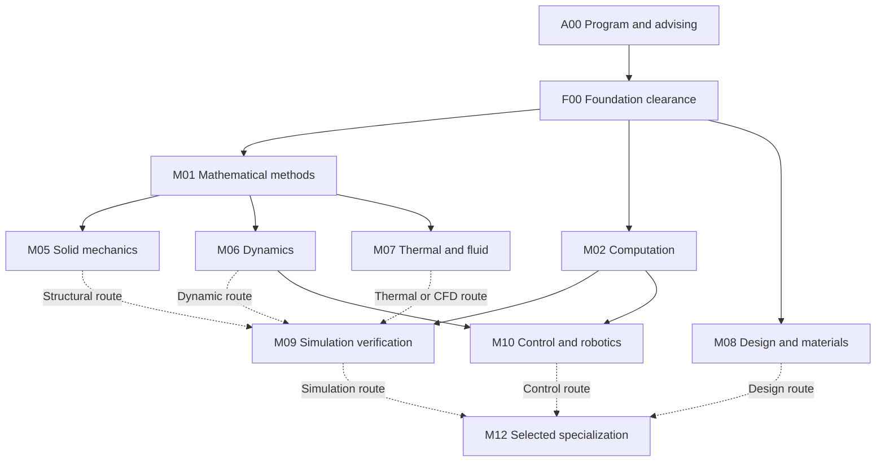
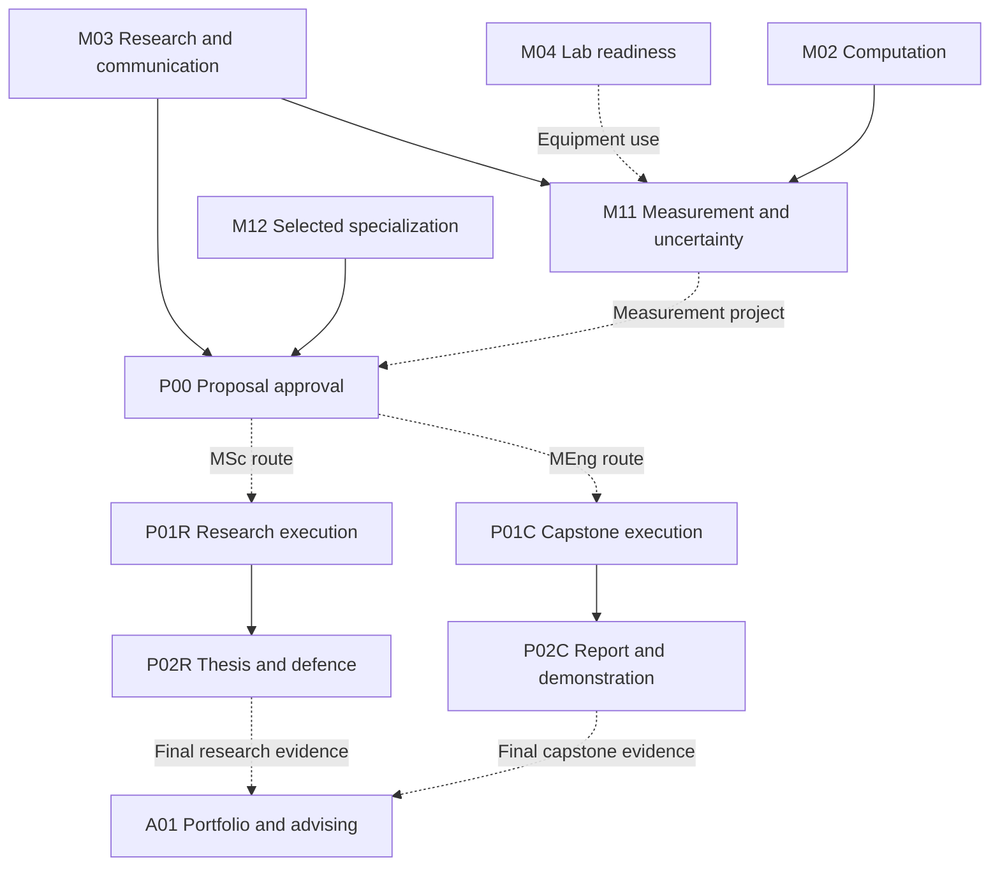

# Master’s mechanics curriculum dependency map

**Version 0.1 · 12 October 2026 · Working proposal**

This map consolidates proposed learning-block dependencies, assessment gates, tools, Google Classroom release practices, and labour-market-information (LMI) decision points for graduate mechanical engineering. The workbook [`masters-mechanics-curriculum-map.xlsx`](masters-mechanics-curriculum-map.xlsx) contains the editable registers and assessment-record template.

## Scope and evidence status

The available request establishes the scope—master’s mechanics, Google Classroom dependencies, curriculum planning, and labour-market advising—but supplies no curriculum files. Google Drive was unavailable and no curriculum files were attached. **The private curriculum has not been reviewed.** No prior completion, student result, institutional approval, or existing Classroom configuration is inferred. The working domain is graduate mechanical engineering; automotive/service mechanics or another specialty requires a revised map.

The institution, specialty, degree route (MSc/MEng), official course codes, credits, durations, offering dates, workload, entry qualifications, existing assessments, tool access, and target job region remain unconfirmed. IDs identify proposed learning blocks, not official course codes. Blocks may span or combine courses; their count is not a credit or degree-course requirement. Do not infer a timetable, graduation date, or duration-based critical path.

The University of Alberta is included only as an external example of why route selection matters: its public Mechanical Engineering [MEng page](https://www.ualberta.ca/en/engineering/mechanical-engineering/graduate/master-of-engineering.html) describes eight graduate courses and a capstone; its [MSc page](https://www.ualberta.ca/en/engineering/mechanical-engineering/graduate/master-of-science.html) describes five graduate courses and a thesis, with supervisor confirmation before applying. These are not requirements for the learner’s program.

## Dependency maps

Solid arrows are proposed prerequisites. Dashed arrows are conditional on the selected specialization or project. Only required branches should be activated once the actual program and learner route are confirmed.

F00 checks relevant undergraduate physics and design foundations as well as mathematics; a mathematics result alone does not clear readiness for M05–M08. M09 requires M02 **and** the selected physics branch (M05 **or** M06 **or** M07); coupled models can require multiple branches. M10 requires M06 **and** M02. Physical robotics additionally requires M04/G03 lab clearance. The workbook’s dependency register records these AND/OR and conditional relationships, including prerequisites not shown in the simplified diagram.

Research and communication start early and run alongside technical work. Lab authorization precedes equipment use; measurement training may accompany advanced coursework. The MSc and MEng project routes are alternatives determined by the actual program.

Project simulation additionally requires M09. Project measurements require M11 and applicable G03 clearance. Research supervision, capstone review, course-credit audits, ethics, and professional-development milestones must be matched to the actual program. This map does not approve project data collection.

## Sequence and gates

1. Confirm A00/G00 and assess F00/G01. Document equivalence or bridge only demonstrated gaps.
2. Run M01, M02, and M03 in parallel when official course rules permit. Complete M04 before equipment use.
3. Enter only applicable physics/design branches. Add M09 or M10 after their prerequisites.
4. Coordinate M11 with the approved experimental branch. Review L2 evidence before selecting M12/G04.
5. Approve P00/G05 before starting the selected project route; validate execution at G06.
6. Complete the institutional final assessment and course audit at G07, then finish shareable portfolio evidence and L5/G08. Career planning may begin at A00.

G00–G08 are reusable proposed gate templates, not official rubrics. Keep a separate record for each assessed module or lab, including criterion source/version, decision, evidence reference, assessor, and date. No passing grade, validation tolerance, or institutional criterion has been invented. If a gate is unmet, record the gap and remediation or branch change before releasing dependent work; topic order, submission status, and scheduled dates do not establish readiness.

| Gate | Purpose | Required evidence (summary) |
| --- | --- | --- |
| G00 | Confirm program and route | Institution, specialty, degree route, admission/course rules, learner goals |
| G01 | Clear foundations | Transcript/equivalence and targeted diagnostic; assessor records readiness or bridge |
| G02 | Verify model/design per module | Assumptions, equations/geometry, units, boundary/acceptance conditions, reference checks, numerical error where relevant |
| G03 | Authorize lab/equipment use | Local training, access permission, risk controls, calibration, supervised dry run as applicable |
| G04 | Review specialization | Branch readiness, degree fit, L2 evidence, goals, offerings, tool access |
| G05 | Approve proposal | Problem, literature, methods, resources, schedule, reviewer/supervisor, ethics/data approvals |
| G06 | Validate project execution | Versioned results, benchmark/refinement, limitations, uncertainty; measurement/calibration evidence where applicable |
| G07 | Review program completion | Route-specific final deliverable/examination, verified credits and institutional milestones |
| G08 | Review portfolio/advising | Shareable evidence, role/credential requirements, L5 review, documented next actions |

Suggested accountable roles, missing criteria, and fuller gate evidence are in the workbook.

## Classroom, tools, and LMI

### Google Classroom proposal

Google documents topics, attachments, rubrics, drafts, scheduling, and assignment to individuals/groups in its [assignment guide](https://support.google.com/edu/classroom/answer/6020265?hl=en), and rubric creation/reuse in its [rubric guide](https://support.google.com/edu/classroom/answer/9335069?hl=en). This map proposes an instructor-managed workflow; **automatic prerequisite unlocking has not been verified, and no course or assignment was changed.**

Use stable topic prefixes and module IDs. Create a separate gate assignment with the applicable official rubric and evidence requirements. Keep dependent work in draft until an instructor has verified every prerequisite/equivalence and recorded the criterion source, decision, evidence link, assessor, date, selected branch, and release date. Return documented remediation or review a changed branch before release. Confirm account edition, teacher role, roster, and course ID first. Keep private learner records separate from shared teaching material.

### Tools

The workbook lists ten tool capabilities (T01–T10): Classroom; Drive/document workflow; numerical environment; CAD/materials; structural FEA; thermal/CFD; control/robotics; compute/accessibility; supervised lab/measurement; references/reproducible archive. These are capabilities to confirm, not purchase or installation decisions. Solver-specific tools apply only to selected branches. Verify access, license, version, accommodations, and a representative computation/CAD/simulation benchmark before sequencing dependent work. Classroom mobile access alone does not establish access to a solver or laboratory.

### Labour-market evidence

Job Bank’s published 2025–2027 mechanical-engineer outlook (NOC 21301) is **Moderate for Alberta and Edmonton** and **Limited for Wood Buffalo–Cold Lake**. It was updated 10 December 2025 and retrieved 12 October 2026. This regional comparison supports asking which location and role the learner targets; it neither ranks specific tools nor predicts individual hiring. See [Job Bank occupational outlooks](https://www.jobbank.gc.ca/outlookreport/occupation/2755).

No employer-posting sample has been reviewed. Conditional sequencing proposals are: L1 confirm role, occupation, region, and credential requirements; L2 collect dated postings and map repeated skills to outcomes before elective selection; L3 compare project scope with validated role evidence, goals, reviewers, and available tools before G05; L4 refresh evidence at a project milestone; L5 compare completed evidence with current postings and credentials when advising. Structural simulation, control, or thermal-fluid emphasis is conditional on validated postings and must not override official prerequisites. Record employer, role, occupation, region, posting/retrieval dates, URL, required/desired skills, credentials, related outcome, sample scope, and proposed change. A single posting is not a repeated pattern.

## Missing inputs and use

The workbook’s Missing Inputs register contains I01–I12, suggested information sources, impacts, and next actions. The first essential input is the current syllabus/course list with institution, degree route, course codes, and version/date. Also obtain prior-learning evidence, official rubrics, course/credit rules and offerings, tools/lab access, reviewer/resources, target role/region, and current Classroom structure.

When sources arrive, preserve official requirements separately, replace proposed links with cited relationships, reconcile prior work, and leave unresolved assumptions explicit. Do not silently populate learner completion, institutional approval, degree requirements, or Classroom configuration.

## Workbook contents and checks

The editable workbook has dedicated sheets for learning blocks, proposed dependencies, gate templates, blank gate records, tools, LMI actions, Classroom workflow, missing inputs, and sources. Its 20 blocks, 46 dependency records, 9 gates, 10 tool capabilities, and 12 missing inputs are proposal data. Conditional relationships remain conditional; validating IDs or acyclicity does not make every branch mandatory. The workbook intentionally has no formulas or automated release logic; formulas were therefore not applicable. Its records are a starting point for source validation, not evidence that the private curriculum has been reviewed.

See [AUTOMOTIVE-TRACK.md](AUTOMOTIVE-TRACK.md) for the proposed automotive/service branch.
See [SERVICE-MANUAL.md](SERVICE-MANUAL.md) for the service manual template.
